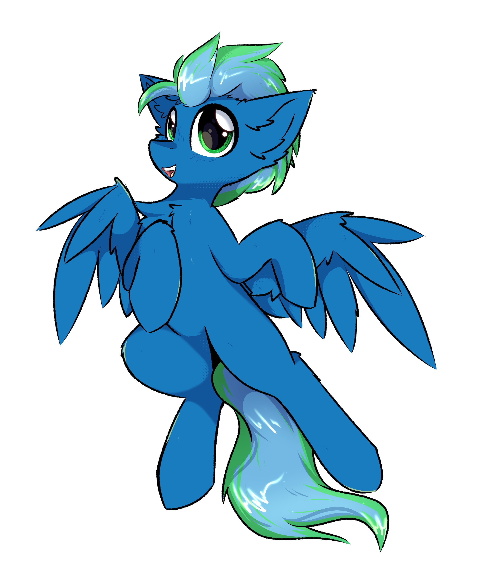

# Hey, I'm Florian — aka Timeraa

24, from Germany. DevOps dev by day, tinkerer by nature.

I got into programming as a kid messing around with Minecraft plugins in Java. That led to Discord bots, which pulled me into JavaScript and Node.js. Somewhere along the way I built [PreMiD](https://premid.app) — a tool that shows what you're watching or listening to on your Discord profile. It's grown to over half a million active users, which still feels surreal. Building it taught me pretty much everything I know about shipping real software — frontend, backend, infra, all of it.

These days I work as a DevOps & Medior Developer at [AutoflexBV](https://github.com/AutoflexBV) and co-founded [Recodive oHG](https://recodive.com/) on the side.

---

### Certified

- **Mid-Level Vue.js Developer** — [View Certificate](https://certificates.dev/c/9cc53f9a-64f2-4920-b773-8a08a684a7d5)

---

### Tech I work with

**Languages**

**Frontend**

**Backend & Infra**

**Databases & Messaging**

**Tools**

---

### Outside of code

Music, gaming, hiking, roller coasters, and way too many Disney movies. I like things that go fast or tell a good story — preferably both.

---

### Get in touch

- **Email:** [me@timeraa.dev](mailto:me@timeraa.dev)
- **LinkedIn:** [Timeraa](https://www.linkedin.com/in/Timeraa)
- **Discord:** Timeraa
